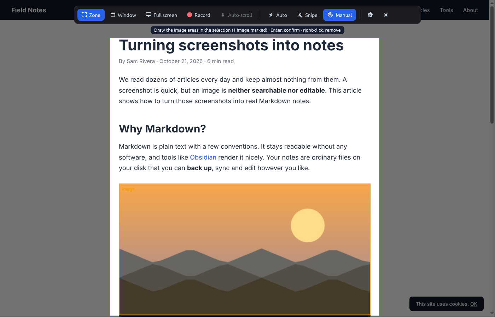
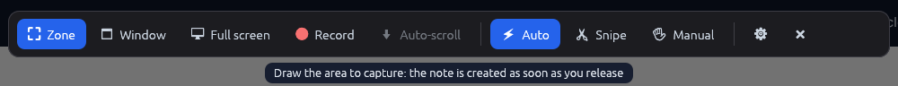
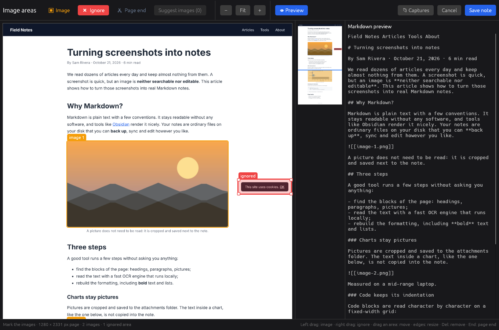
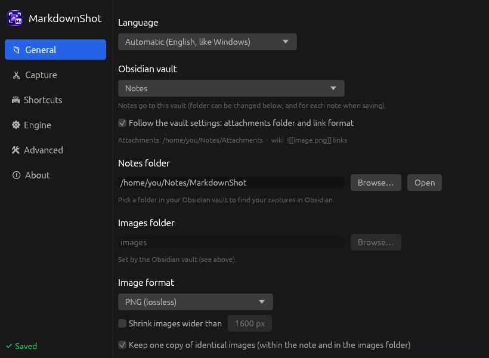

<p align="center">
  
</p>

<h1 align="center">MarkdownShot</h1>

<p align="center">Screenshot to Markdown note, entirely on your computer.</p>

Draw a rectangle on the screen, the way you would with the Windows Snipping Tool. MarkdownShot reads the
text, rebuilds the formatting (headings, bold, italic, lists, code blocks, quotes, tables), crops the
pictures and writes a Markdown note ready for [Obsidian](https://obsidian.md). A capture takes one or two
seconds. There is no account, no API key and no network access involved.



## Features

**Capture**

- `Ctrl+Alt+S` (or the Print Screen key) freezes the screen and opens a capture toolbar: Zone, Window,
  Full screen or Record.
- Three modes, for single captures and recordings alike:
  - **Auto**: pictures are found and cropped for you, and the note is written as soon as you release the mouse.
  - **Snipe**: the capture opens next to its Markdown, ready to copy. Nothing is written unless you click
    "Save note". Handy for text without pictures.
  - **Manual**: you draw the picture areas yourself inside the selection, then press `Enter`.
- **Scroll recording** (`Ctrl+Alt+R`): draw the area and MarkdownShot scrolls the page to the bottom by
  itself, waiting for each frame to settle. The frames are stitched into one page without duplicates.
  Sticky headers, sidebars, cookie banners and floating buttons are detected and kept only once. You can
  also scroll by hand (`D` switches).

**Conversion**

- Headings from the measured text size, **bold** from stroke weight, *italic* from letter slant, bulleted
  and numbered lists, quotes, paragraphs joined back together.
- Code blocks keep their exact spacing: each character is placed on the monospace grid, small symbols
  (`^ | ` `` ` `` `- _`) and tree characters (`├─ └─ │`) are re-read from the image, the language is
  guessed from the code or from the site's tab or label, and editor line numbers are removed. A line cut
  off at the edge of its block ends with `…`.
- Bordered tables and borderless grids become Markdown tables. Multi-column lists become a single list.
- Pictures (photos, charts, diagrams) are cropped and inserted where they belong. Text inside a chart stays
  in the picture, and so does a caption placed beside it. Math formulas (MathJax, KaTeX) are kept as
  pictures.

**Notes**

- YAML front matter (date, source window, tags), Markdown also copied to the clipboard, and a notification
  that opens the note or the review window.
- Obsidian vaults are detected, and their settings are followed: attachments folder and link style
  (wikilinks or Markdown links). The folder can also be changed for a single note when saving it.
- Images as optimized PNG, lossless WebP (about 2.5 times smaller) or JPEG, with optional downscaling of
  wide images and a single copy of identical images.

**Review window**

- The whole page, even a very long one, with zoom and a minimap.
- Draw *image* areas with the left button and *ignore* areas (ads, banners) with the right button.
- A **page end** line drops everything below it (comments, footer).
- Live Markdown preview. The same window reviews the last capture (right-click its notification) or opens
  an existing image.

**Other**

- English and French interface, following the Windows language unless set in the settings.
- Optional GPU inference with DirectML; the CPU takes over when the GPU cannot be used.
- Update check at startup, at most once a day. Clicking the notification installs the new version and
  restarts MarkdownShot.





## Installation

MarkdownShot runs on Windows 10 and 11 (64-bit). Each [release](../../releases) contains:

| File | Use |
|---|---|
| `MarkdownShot-x.y.z-windows-x64-setup.exe` | Installer (recommended): Start menu entry, uninstaller, one-click updates |
| `MarkdownShot-x.y.z-windows-x64-portable.zip` | Portable version: unzip anywhere, nothing is installed |

**Installer.** Run the setup file. It installs for the current user without administrator rights
(`%LOCALAPPDATA%\Programs\MarkdownShot`) or for all users (`C:\Program Files\MarkdownShot`), and can start
MarkdownShot with Windows. Running a newer installer updates the existing installation. The uninstaller
offers to remove your settings too; your notes are never touched.

Silent install: `MarkdownShot-x.y.z-windows-x64-setup.exe /VERYSILENT /CURRENTUSER` (or `/ALLUSERS`).

**Portable.** Unzip the archive and run `markdownshot.exe`. Create an empty `markdownshot.toml` next to it
to keep the settings in that folder (USB drive).

The executables are not code-signed yet, so Windows SmartScreen may warn on first launch
("More info", then "Run anyway").

On first launch the settings window opens: pick the notes folder, for example a folder in one of the
detected Obsidian vaults. MarkdownShot then lives in the notification area. Left-click the icon to
capture, double-click it for the settings, right-click it for the menu.



## Usage

| Action | How |
|---|---|
| Open the capture toolbar | `Ctrl+Alt+S` (configurable, Print Screen possible) |
| Zone, Window, Full screen, Record | toolbar buttons, or `Z`, `W`, `F`, `R` |
| Change mode | toolbar button, `M` (Auto, Snipe, Manual) or `S` (Snipe); the choice becomes the default |
| Capture in Auto mode | draw the area: the note is written on release |
| Capture in Snipe mode | draw the area: the preview opens, "Copy" or `Enter` copies the Markdown, `Esc` closes |
| Capture in Manual mode | draw the area, draw the pictures inside it, then `Enter`, `Space` or double-click |
| Remove a picture area | right-click it (`Backspace` removes the last one) |
| Cancel | `Esc`, or right-click outside the areas |
| Record a scrolling page | `Ctrl+Alt+R` (or `R`), draw the area; it scrolls to the bottom by itself, `Esc` stops earlier |
| Review the last note | right-click the notification, or "Review last capture" in the menu |

In the review window: left drag creates an image area, right drag an area to ignore, dragging an area moves
it, its edges resize it, `I` and `X` switch the type of the selected area, `Del` removes it, `Ctrl` + wheel
zooms, `End` places the page end. "Suggest images" adds the automatically detected pictures.

While auto-scroll runs, leave the mouse alone; moving it hands control back to you. If the area does not
scroll with the mouse wheel, the label says so and you can scroll by hand. When scrolling by hand, keep a
moderate pace; a red label asks you to slow down if needed.

`Ctrl+Shift+S` is not the default shortcut because it means "Save as" in many applications. Shortcuts can
be changed in the settings.

## Configuration

Everything is available in the settings window and applies immediately. It is stored in
`%APPDATA%\MarkdownShot\config.toml` (or `markdownshot.toml` next to the executable in portable mode),
which can also be edited by hand.

```toml
[output]
notes_dir = 'C:\Users\you\Documents\Obsidian\Captures'
images_dir = 'images'            # relative to notes_dir, or an absolute path
wikilinks = true                 # false: standard Markdown links 
filename = '{date} {time} - {title}'
front_matter = true
tags = ['capture']
copy_markdown = true
open_after = 'none'              # none | note | obsidian
follow_vault = true              # inside an Obsidian vault, use its attachments folder and link style
image_format = 'png'             # png | webp | jpeg
jpeg_quality = 90
max_image_width = 0              # 0 keeps the original size
dedupe_images = true

[hotkeys]
capture = 'Ctrl+Alt+S'
record = 'Ctrl+Alt+R'

[capture]
mode = 'auto'                    # auto | manual | snipe
manual_suggestions = false       # Manual mode: suggest the detected pictures in the review window
frames_per_second = 8            # recording without auto-scroll
auto_scroll = true
keep_long_capture = false        # also save the stitched page as PNG

[engine]
quality = 'balanced'             # fast | balanced | accurate
full_width_images = true         # include text placed beside a picture in the picture
layout = true                    # layout model (charts, diagrams)
gpu = false                      # DirectML; MARKDOWNSHOT_GPU=1 forces it

[interface]
language = 'auto'                # auto | en | fr

[updates]
check = true
```

| Quality | Detection | Recognition | Notes |
|---|---|---|---|
| `fast` | PP-OCRv6 tiny | PP-OCRv6 tiny | about 4 times faster, a few more reading errors |
| `balanced` | PP-OCRv6 tiny | PP-OCRv6 small | default |
| `accurate` | PP-OCRv6 small | PP-OCRv6 small | for small text |

## Command line

```text
markdownshot open IMAGE        open an image in the review window
markdownshot snipe IMAGE       open an image in the Snipe preview (nothing is written)
markdownshot convert IMAGE...  [--out FOLDER] [--zone X,Y,W,H] [--stdout] [--quality fast]
markdownshot stitch FOLDER     [--image page.png] [--stdout]
markdownshot record --zone X,Y,W,H [--auto] [--image page.png] [--no-note]
markdownshot --help
```

`stitch` assembles the screenshots of a scroll (PNG files sorted by name), for example frames extracted
from a screen recording, and converts the result.

## Privacy

Everything runs locally with [ONNX Runtime](https://onnxruntime.ai) and
[PaddleOCR](https://github.com/PaddlePaddle/PaddleOCR) models. Captures and text never leave your
computer. The only network requests are the optional update check, which asks the GitHub API for the
latest release, and the download of an update when you accept it.

## Building from source

Requirements: [Rust](https://rustup.rs) stable and Python 3 (to download the models).

```bash
python scripts/fetch_models.py --runtime windows   # models and ONNX Runtime, from PyPI
cargo build --release
copy models\* target\release\
target\release\markdownshot.exe
python scripts/package.py                          # portable zip in dist/
```

The engine and the command line also build on Linux and macOS (`python scripts/fetch_models.py` fetches
the runtime for the current system); the tray application targets Windows. Cross-compiling from Linux
with MinGW (`x86_64-pc-windows-gnu`) is configured in `.cargo/config.toml`.

### Tests and benchmarks

```bash
python scripts/fetch_models.py
cargo test --release --workspace
```

The integration tests in `crates/core/tests` convert reference pages in `testdata/` (full page, stitched
scroll at 100% and 125%, a compressed video, side captions, grids, tables) and check the result.

- `testdata/calibration`: synthetic lorem ipsum pages in light and dark themes at 100% and 125%, with
  the cases known to be hard. `harness/calibration.py` scores text, structure, code and picture framing
  (see [its README](testdata/calibration/README.md)).
- `harness/realbench.py`: real documentation sites rebuilt locally from their sources (Rust Book, Rust by
  Example, mkdocs-material, Godot, React Native, Flask, Python docs, FastAPI, cp-algorithms). The ground
  truth (pictures, formulas, code blocks, text) is read from the page DOM. `--compare before.json` shows
  the difference with a previous run.
- `harness/scrollbench.py`: scroll recording on real pages in a browser.

Debugging: `cargo run --release -p markdownshot-core --example dump -- capture.png` prints the lines,
styles and regions; `--example stitch -- frames/ page.png` runs the stitcher alone.
`MARKDOWNSHOT_DEBUG=1` prints the picture detection details.

### Releases

CI (`.github/workflows/build.yml`) runs the tests on Linux and builds Windows. Every push to `main` that
passes is released: tag, installer and portable zip, after a silent install and uninstall
test of the installer. The version is the next patch of the series set in `Cargo.toml`
(`scripts/next_version.py`): `1.0.0`, then `1.0.1`, and so on. Set `1.1.0` in `Cargo.toml` to start a new
series.

Optional repository secrets: `SIGNING_PFX_BASE64` and `SIGNING_PFX_PASSWORD` sign the executable and the
installer (`scripts/sign.ps1`). Without them signing is skipped.

## Project layout

```text
crates/core     engine library: image in, document out
  ocr.rs          text detection (DBNet) and recognition (CTC) with per-character positions
  layout.rs       layout model (PicoDet): figures, tables, titles
  style.rs        pixel measurements: x-height, stroke weight, background, bullets, quote bars
  figures.rs      pictures: manual areas, layout model, pixel detection, line art, cropping
  panels.rs       boxes (code blocks, consoles, callouts, framed screenshots), bordered table grids
  order.rs        reading order (XY cut, columns)
  markdown.rs     blocks (headings, paragraphs, lists, code, quotes, pictures) and Markdown output
  glyphs.rs       code block grid and symbol re-reading
  lang.rs         code language guessing, language labels and tabs
  formulas.rs     display math detection
  stitch.rs       scroll recording: frame offsets, fixed elements, stitching
  output.rs       note and image files
crates/app      Windows application: tray icon, hotkeys, capture overlay, recorder, notifications
  ui/             egui windows (software rendering): toolbar, settings, review
  obsidian.rs     Obsidian vaults (obsidian.json) and vault settings (.obsidian/app.json)
  update.rs       latest GitHub release, installer download
  i18n.rs         interface language: t!("French", "English")
installer       Inno Setup script
scripts         models, packaging, versioning, signing
harness         benchmarks and scoring
testdata        reference pages, calibration pages
```

## Known limitations

- Links are kept as plain text, since the URL is not visible on screen.
- Formulas stay pictures (no LaTeX output).
- A table drawn with icons or check marks, or placed on a tinted frame, stays a picture. In a table with
  merged cells, the text goes to the first cell.
- Scroll recording is vertical only.
- A chart drawn directly on the page background, with no frame or background of its own, can have its
  title and axis labels read as text.

## License

MIT, see [LICENSE](LICENSE). Third-party components: [THIRD_PARTY.md](THIRD_PARTY.md).
